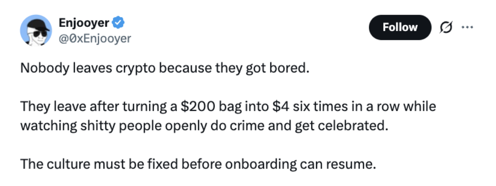
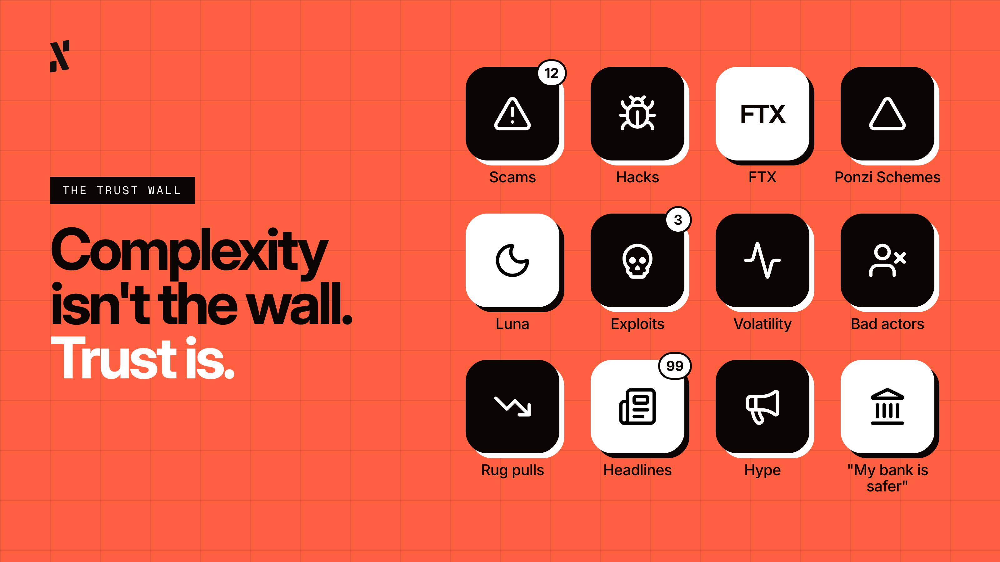
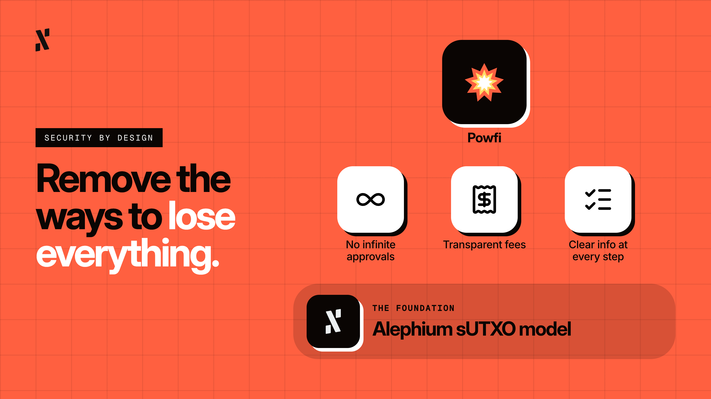

*By Pepper, Head of Marketing at Alephium*

- - -

The first iPhone was announced in January 2007, back when I was 14 years old. I remember being 16 when I first played on one, and it was basically an iPod Touch with the ability to call people. To be honest, I wasn’t convinced it was going to be successful, and the price point was crazy. A year later, and I was to be proven completely wrong. I hold up my hands.

By 2010, smartphones had transcended from a niche gadget for early adopters with plenty of surplus cash, to arguably the most culturally significant piece of handheld technology ever. It seemed to happen almost overnight, when the iPhone 4 launched. Coincidentally, that was the first iPhone I owned, and suddenly I was one of the cool kids, waving goodbye to my Blackberry and BBM. For years, smartphones had been pretty rough and rudimentary, but when the iPhone 4 launched, dominance was achieved.

Some will say the iPhone moment happened in 2007 with Steve Jobs, but I think it was actually in 2010, when a refined product came to market. This “iPhone moment” isn’t unique. The internet, email, and social media all had their “moments” too. They all first existed as impressive but largely inaccessible things, with design later catching up and making them useful for the masses. When the design did catch up though, change happened almost overnight, and the “before” versions were either forgotten or forgiven.

What does this have to do with DeFi? Well, Bitcoin is only two years younger than the iPhone, and yet it still seems to be building towards its “moment”. You could argue DeFi started with smart contracts and Ethereum about a decade ago, but it’s still a long time to be waiting for the moment when DeFi clicks for the mainstream and overnight change occurs. Frustratingly, it seems even AI is having its moment before DeFi.

Crypto’s tech is great, liquidity is real, and possibilities are endless. For those like you and I, already on the inside, we know it is fantastic technology. So, after all this time, why has DeFi still not had its iPhone moment?* I’ll use this column to launch an honest, and perhaps at times brutal, assessment.

*\*Some may argue the moment has already been and gone, but I disagree.*

## Complexity or Education?

Every public talk I go to, conference I attend, or X Space I listen in on will, likely, at some point, talk about adoption, or “onboarding the masses”. Every time, someone will blame complexity for why normies still aren’t here in larger numbers. They say DeFi is too technical, jargon-heavy, and too saturated with chains, wallets, bridges, seed phrases, tokens, gas fees, influencers, protocols, and more. I mean, they’re right, but has complexity really ever stopped humans from doing the things they want to do?

Building the pyramids was complex, so much so that even to this day (myself included), very few understand how it was even humanly possible. Spreadsheets are complex, so are tax returns, and don’t even get me started on mortgage applications. Complexity is found in all parts of adult life, but people do these complex things because there is a reward on the other side that is worth the effort. There are also systems, advisors, and interfaces that can absorb large parts of the difficulty.

Making DeFi intuitive is great, and I love to see protocols and dApps make things easy for users, but even if they are absolutely foolproof, complexity is not the issue here. I think the real reason is somewhere between a lack of trust and a lack of desire.

## The Trust Wall

I’ve been in crypto for nine long years now, and from my observations and experience, those who don’t use crypto aren’t particularly confused by it. They’ve heard of it, understand what it offers, and have even tried it, at least at a surface level. However, they just don’t trust it. Scams, hacks, Ponzi schemes, and so many other malicious events and bad actors have just put them off. They believe their money is safer in the bank.

They might’ve developed this sense of mistrust from seeing snippets of news, whether it was FTX and Luna, or one of any other of the countless exploits. They perhaps saw the volatility of Bitcoin and Ethereum and decided they don’t want to take that risk and see their investment become a fraction of what it once was. 

Clearly, complexity is not the main issue here, but rather reputation and trust. Reputations are built over time, through consistent, honest, and occasionally boring delivery. This is the kind of great work that Alephium has done over the past five years; saying they will do something, and then doing it. But Alephium, like the rest of DeFi, is still waiting for its iPhone moment.

## iPhones Boasted Good & Intuitive Design

I wonder what made the iPhone so much more “sticky” than its predecessors and rivals. You could argue that it felt safe and logical, that anyone could pick it up and make sense of it quickly. The aesthetics, interfaces, and designs were so carefully thought out that it was hard to do something wrong as a user.

When we apply this kind of train of thought to DeFi, I don’t believe it’s really about making prettier and more intuitive interfaces (although it helps), but about removing the ways in which someone could accidentally lose everything. To do that, we need to remove infinite approvals, offer transparent fee structures, and provide clear information at every step of the transaction. These are things I proudly believe Alephium has done, which is part of why our loyal users are still here. 

That same intentional architecture extends to Powfi, which embraces Alephium’s sUTXO model to eliminate all sorts of approval-based attacks that have plagued EVM wallets and chains. When you interact with Powfi, you don’t need to trust promises and guarantees, because you know the architecture is secure, and that, dear reader, is more critical than any interface design decision.

## The iPhone Moment Is Still Coming

I don’t know what set of global, economic, micro or macro circumstances would be required for DeFi to have its iPhone moment. Nobody does. But I do genuinely believe it's coming, because at some point, if the industry keeps the users it has and continues to welcome more, it will hit a tipping point. That tipping point, however, can only arrive if the infrastructure is good enough to deserve it.

Of course, I’m biased in favour of Alephium. I see Powfi, Linx, Aura, Factor, and other dApps, as well as the builders behind them, and I see that they understand that design has to earn the trust of users. Building a great product on a weak or vulnerable chain is an accident waiting to happen. Therefore, Alephium might not yet have the pull of some of the mega chains, making the road to success slower, but ultimately, it’s the right road to be on from a security and architectural perspective. 

I thank you, applaud you, and appreciate you being here. If you’re reading this, I can only assume you support Alephium, and that what it offers has “clicked” for you. Moving forward, I hope that the chain and Powfi will receive greater recognition, akin to the iPhone, and we will have our “moment”. When that day comes, I hope you’ll celebrate alongside me.
