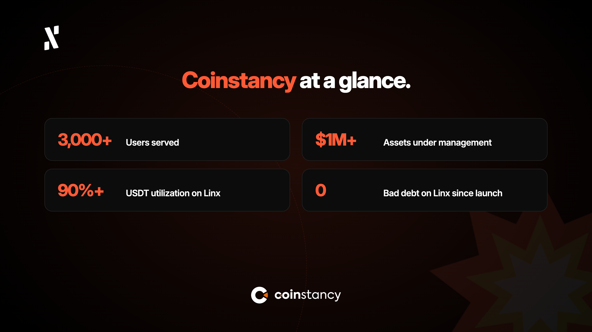
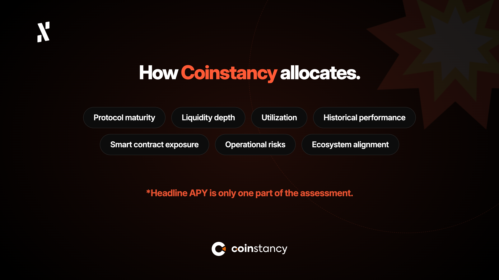

Over the past decade, decentralized finance has shown that financial infrastructure can become more open, transparent, and programmable. Yet, for many mainstream users and capital allocators, DeFi has remained difficult to access because of technical complexity, fragmented liquidity, and risk-management challenges. 

Coinstancy addresses these challenges by combining accessible on-chain savings and investment products with a structured approach to protocol selection, liquidity assessment, and capital allocation.

## A Platform Built for Mainstream Participation

[Coinstancy](https://coinstancy.com) was founded on the premise that on-chain finance should be accessible to anyone, regardless of their technical expertise. As a result, the platform offers stablecoin savings products, curated crypto baskets, and simplified access to digital asset yield strategies. All of this has been developed on top of decentralized infrastructure, removing the same complexities that have kept a large number of mainstream investors away.

Now serving more than 3,000 users, and managing over $1M in assets, Coinstancy is demonstrating that simplified access to on-chain yield is something the market wants. Its [integration with Coinme](https://coinstancy.com/article/coinstancy-integrates-coinme-to-unlock-access-for-us-users/), a regulated US partner, gives Coinstancy access to a broader [US on-ramp infrastructure](https://polygon.technology/blog/case-study-how-coinstancy-built-a-stablecoin-savings-product-for-mainstream-users-on-polygon) and supports its ambition to reach beyond a purely crypto-native audience.

“For users, on-chain finance should feel simple. Behind that simplicity, every allocation requires a clear understanding of where returns come from, how liquid the position is, and which risks it carries. That is the approach we bring to Alephium.” says Armand Bouchard, CEO of Coinstancy.

This approach guides Coinstancy’s choice of infrastructure and underpins its decision to deploy stablecoin liquidity through Linx within the Alephium ecosystem.

## Why Alephium

Swiss Layer 1 blockchain [Alephium](http://alephium.org) has been engineered with security and scalability as foundational principles. Its BlockFlow sharding architecture allows the network to scale beyond 20,000 transactions per second by increasing the number of shards, while preserving the simplicity of a single-chain user experience. Its stateful UTXO model is designed to improve security and reduce certain classes of smart contract risks that have historically affected DeFi protocols.

Alephium’s Proof-of-Less-Work consensus mechanism offers a unique and more sustainable twist on Proof-of-Work (PoW). It builds on some of the security principles associated with Proof-of-Work, while adapting them for a programmable blockchain environment. Since its launch in November 2021, Alephium has focused on reliability and infrastructure resilience, two criteria that matter when evaluating where capital can be deployed.

Alephium has recently initiated “Phase Two” of its project roadmap, all centered around a core ideal of “Aligned Economics”. This has seen [Powfi](http://powfi.alephium.org), a CLMM DEX and liquid staking platform, bring a fresh design that inclines application-layer activity to directly strengthen the base layer. This should strengthen the connection between application-layer growth and the underlying network economy. 

## Why Linx Matters for Coinstancy’s Alephium Deployment

Coinstancy’s initial Alephium deployment is taking place through [Linx](https://app.linxlabs.org/), a lending protocol and DEX aggregator that has established itself as one of the most active and relevant DeFi applications in Alephium’s ecosystem. Linx has consistently posted USDT utilization figures over 90%, alongside strong APY rates and zero bad debt since launch.

Coinstancy’s decision to deploy stablecoin liquidity through Linx reflects its assessment of both the protocol and Alephium’s DeFi infrastructure. The yield opportunity is considered alongside protocol quality, liquidity conditions, utilization, historical performance, and risk controls, as part of a broader allocation decision.

The deployment extends Coinstancy’s strategy of selecting technically sound DeFi infrastructure to support its long-term development. For Alephium, the arrival of more structured capital allocation strategies can help demonstrate that its ecosystem is becoming relevant for users and platforms looking beyond short-term incentives.

## Coinstancy’s Allocation Framework

Coinstancy evaluates each deployment across protocol maturity, liquidity depth, utilization, historical performance, smart contract exposure, operational risks, and ecosystem alignment. The objective is to assess the return opportunity together with the conditions and risks under which capital would be deployed.

The review also considers concentration risk and exit conditions. After deployment, ongoing monitoring helps the team reassess whether a position continues to meet its allocation criteria as liquidity and protocol conditions evolve.

Headline APY is one part of that assessment. For users, Coinstancy’s role is to translate this analysis into access to selected DeFi opportunities through a simpler experience, combining ease of use with a structured approach to capital allocation.

## Why Alephium? DeFi Maturity is Key

At its core, Coinstancy's Alephium deployment is a story about infrastructure maturity. Platforms that manage user capital evaluate allocations against a specific framework, looking at where the yield comes from, liquidity depth, smart contract maturity, concentration risk, exit conditions, and ongoing monitoring after deployment. Generic ecosystem narratives do not satisfy that framework, but specific, verifiable signals do.

Alephium satisfies several of them directly. The yield available through Linx is driven by genuine utilization, consistently above 90%, rather than unsustainable token emissions. Powfi's fee-routing mechanism connects yield to real trading activity. Alephium's sUTXO model and purpose-built virtual machine reduce the smart contract attack surface that has caused repeated losses on EVM-compatible chains. The ecosystem is not dependent on a single protocol, with Linx, Powfi, and a growing pipeline of independent applications providing meaningful deployment optionality.

One factor that sits outside quantitative metrics, but carries real weight in a capital allocation decision, is team quality. Alephium's core contributors have demonstrated a consistent ability to identify problems early, respond decisively, and implement solutions at speed. In an industry where how a team handles difficulty matters as much as what they build in favourable conditions, that track record is a meaningful signal.

For Coinstancy, the broader takeaway is as follows. As DeFi matures, platforms managing real user capital must increasingly look for chains that combine technical robustness, transparent on-chain performance, and a core team that has proven it can perform under pressure. Alephium is now firmly in that conversation.

Coinstancy’s contribution is to connect that infrastructure with accessible on-chain products through protocol selection, risk assessment, and structured capital allocation.

Coinstancy is available at [coinstancy.com](http://coinstancy.com) 

Linx is live on Alephium at [app.linxlabs.org](http://app.linxlabs.org) 

Powfi is now live at [powfi.alephium.org](http://powfi.alephium.org)
