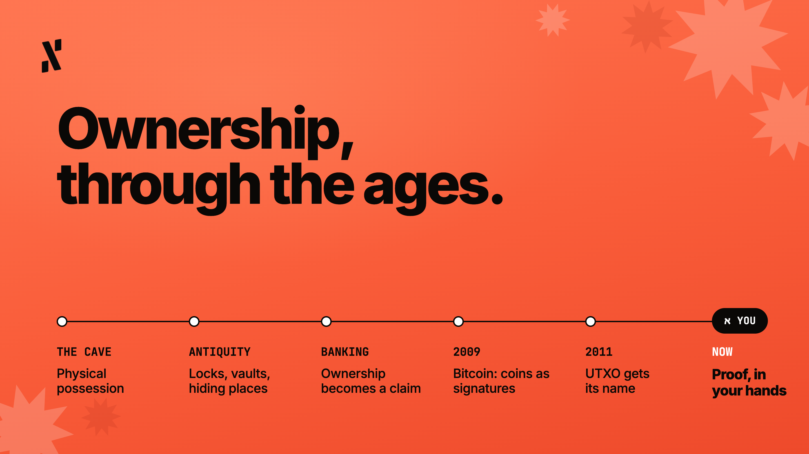
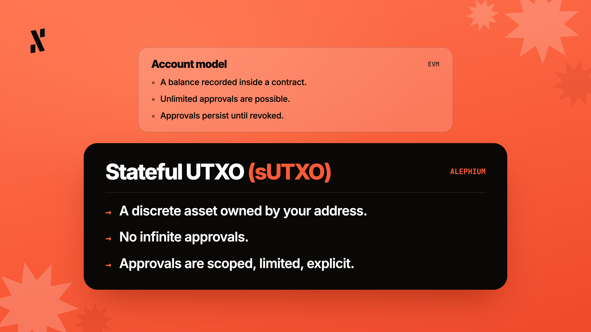
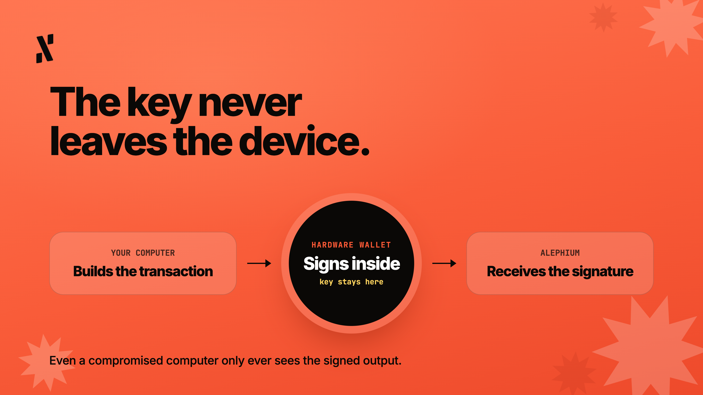

*Column By Pepper, Head of Marketing at Alephium*

- - -

There is a phrase that gets repeated so often in crypto that it has almost lost all meaning (but thankfully not entirely). 

"Not your keys, not your coins." 

I’m sure you’ve heard it by now, or seen it tweeted at least. You might even say it to help others who are new to crypto. Personally, I’ve remixed it into my own version, which is “not your keys, not your cheese”.

My question, to get us kicked off here in this column, is whether you know deep down why this statement is true? And, I don’t mean a vague or intuitive understanding, like because of crypto exchange collapses or bad actors. I’m discussing the architectural level and what's happening technically to make “Not your keys, not your coins” a literal statement.

I chose to write about this topic as there is something more interesting underneath it, and with BTC almost 18 years old now, it’s becoming ancient industry wisdom. Once you align yourself with the vital knowledge I’m sharing with you, a hardware wallet should start feeling like a mythical object that restores sacred human knowledge.

## Humans Have Always Held Things

Since the dawn of time, when nomads and cavemen ruled the vast plains, ownership meant physical possession. A weapon in your hand, the fur rug in your cave, and the loincloth to protect your modesty. The object did not symbolise ownership, because it was ownership. If someone wanted your items, they needed to come to your cave with a spear in hand and take it by force. 

This system continued through the ages, eras, epochs, and revolutions, right up until the birth of financial systems, in particular, banking. Banks found a way to abstract ownership into ledger entries, turning your money into a number in someone else’s database, and converting physical ownership into legal ownership. With this change, people began to physically hold less money, and began to carry their claim, along with the hope that the institutions would honour it.

## Remembering Crypto’s Original Promise

Satoshi’s original Bitcoin whitepaper is a fascinating read in its entirety, but I’m going to pull out just five of my favourite relevant quotes and I think you’ll see how they connect to this topic. 

1. "We define an electronic coin as a chain of digital signatures. Each owner transfers the coin to the next by digitally signing a hash of the previous transaction and the public key of the next owner and adding these to the end of the coin. A payee can verify the signatures to verify the chain of ownership."
2. "A purely peer-to-peer version of electronic cash would allow online payments to be sent directly from one party to another without going through a financial institution."
3. "What is needed is an electronic payment system based on cryptographic proof instead of trust, allowing any two willing parties to transact directly with each other without the need for a trusted third party."
4. "Although it would be possible to handle coins individually, it would be unwieldy to make a separate transaction for every cent in a transfer. To allow value to be split and combined, transactions contain multiple inputs and outputs."
5. "Normally there will be either a single input from a larger previous transaction or multiple inputs combining smaller amounts, and at most two outputs: one for the payment, and one returning the change, if any, back to the sender."

Now, the term UTXO (unspent transaction output) didn’t come into play until 2011, but that’s what Satoshi was basically alluding to. An asset is a discrete object, rather than a variable in a database or a promise from an institution. That asset or object (however you prefer to see it), can only move when a private key authorises it, and it cannot be created or spent without achieving consensus from the network. That is essentially cash logic, but implemented on a decentralised digital network, and that “simple” idea has captured the imagination of millions of people and trillions of dollars.

Some see Satoshi’s original design as a protest against Big Finance and Wall Street (which it was), but for this article I’m choosing to look at it as an architectural decision. By treating the network like physical cash, the system would only need to scan a public timeline to verify which pieces of transactions have or haven’t been consumed. Personally, I love this, and if you’re here reading this, I assume you do too.

Unfortunately, many people overlooked Satoshi’s intention and Bitcoin’s architecture, and immediately gave up this feature after entering this space. They put their coins on centralised exchanges and handed their keys over to custodians. Whether they realised it or not, this rebuilt the abstraction layer they presumably wanted to escape, enriched Big Finance all over again, and then exposed them to the unfortunate reality that sometimes… custodians fail.

## What sUTXO means for you, specifically

Alephium took Bitcoin’s UTXO model and extended it in an interesting direction. 

When you hold $ALPH or any token in an Alephium wallet, you are not holding a balance recorded inside a contract. Instead, you hold a **stateful** UTXO. In Alephium’s version, this sUTXO is a discrete asset object, owned by your address, that cannot be moved without your signature. This happens because the virtual machine was built so that movement without your authorisation is structurally impossible.

On Ethereum-based systems, you can grant a smart contract unlimited access to your tokens, and that approval persists until you explicitly revoke it. Importantly, there are no infinite token approvals on Alephium. With Ethereum-based protocols, one compromised contract or malicious approval you did not read carefully can put your entire balance at risk. Alephium's VM does not work that way, as approvals are scoped, limited, and explicit. The attack surface that has drained hundreds of millions of dollars from EVM wallets does not exist here.

When you hold your own keys on Alephium, the protection is part of our architecture. The token is yours in the same way a coin in your pocket is yours, and no one can spend it without your key.

## The Physical Object

The next part is where I see a hardware wallet becoming more than just physical security. By isolating your private key from any device connected to the internet, you add layers to your protection. Your key gets generated on the device, is stored on the device, and crucially, never leaves the device. Therefore, when you sign a transaction, the signing happens right inside the hardware, so your computer, phone, or browser (wherever you transact with Alephium) never sees the key. They only see the signed output.

As a result of this architecture, even if your computer were to be compromised, with malware watching every keystroke, reading all your files, and intercepting all network activity, they couldn’t steal your key from the hardware wallet. Your private key does not exist on your browsing devices, instead living peacefully on the hardware wallet. 

If you think about this, this is the oldest security intuition known to man, a primal instinct of sorts. People have always protected prized items by placing them in a safe space that cannot be easily accessed, like a safe, vault, locked drawer, or a hiding place. That’s what the hardware wallet is, and by having one and storing funds on it, you have proof of ownership.

## A note on Alephium x Hardware Wallets

There are multiple options for ALPH-compatible wallets. I’m a big fan of the special edition hardware wallet we have with [OneKey](https://onekey.so/), and I think it’s a great option for storing your ALPH for a long time. If cold storage is your game, look no further.

As for accessibility, Ledger is the most capable hardware wallet for Alephium users specifically, as it allows you to sign transactions on our chain. It gives you access to more of the Alephium ecosystem than any other option available, meaning you can use it not just for storing $ALPH, but for interacting with the broader network and its DeFi applications.

Tangem, SafePal, and Goldshell all sell top quality hardware wallets for ALPH too. Whichever one you choose, remember that these hardware wallets are the physical layer of your crypto security. They handle what the hardware handles, which Alephium’s architecture handles what the protocol can handle. In combination, they give you something very close to the original intentions of crypto custody and security. I think Satoshi would be pleased.

## What Ownership Means Right Now

I keep returning to a simple question…

*What does it mean to own something in 2026?*

As far as I’m aware (historians you are welcome to disprove me), for most of the modern financial era, you own a claim that is held by someone else and is contingent on their solvency and good faith. The physical object itself, like a deed, key, or money in your bank account, is a representation of the claim, but not the thing itself.

This is why I like crypto so much, as it offers an amazing alternative. Hopefully you’re nodding your head in agreement. Crypto lets you hold the thing itself, with no need for claims and promises. With a private key, it moves only on your say so. With a hardware wallet, you take things to the next level.

The private key and hardware wallet are not metaphors for ownership, because they are the ownership.

Not your keys, not your cheese.
